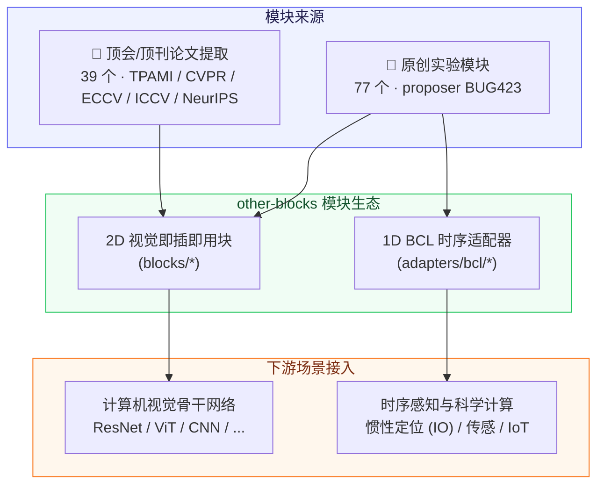
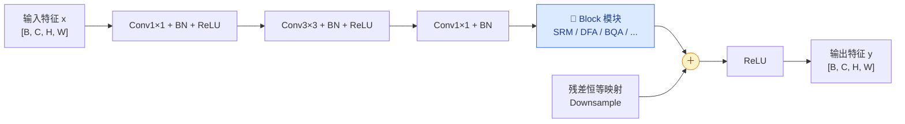

# 🧩 other-blocks

[](https://python.org)
[](https://pytorch.org)
[](https://creativecommons.org/licenses/by-nc-nd/4.0/)
[](#-核心模块体系8-大分类矩阵)
[](#-核心模块体系8-大分类矩阵)
[](#-核心模块体系8-大分类矩阵)

> **other-blocks** 是一个系统整理、实现和验证神经网络功能模块的开源仓库，覆盖计算机视觉（2D）与时序数据（1D BCL 序列）感知任务的即插即用 PyTorch 神经网络模块动物园。

---

## 🖼️ 架构总览与模块流向



### 残差网络即插即用插入机制



---

## ✨ 核心特性

| 特性维度 | 说明与设计规范 |
| :---: | :--- |
| 🧩 **即插即用** | 每个模块封装为独立的 `nn.Module`，零侵入无缝插入任意主流 CNN 或 Transformer 骨干。 |
| 📐 **统一张量契约** | 默认遵循 `[B, C, H, W] → [B, C, H, W]` 形状保持契约，构造函数首参严格固定为 `channels`。 |
| 🧪 **双来源模块** | 包含 77 个原创前沿实验模块以及 39 个源自 IEEE TPAMI、CVPR、ECCV、ICCV、NeurIPS 的顶会论文等价提取模块。 |
| 🌊 **时序生态扩展** | 内置 BCL（Batch-Channel-Length）时序格式适配器，将成熟的 1D/2D 模块无缝迁移至惯性导航与时序分析任务。 |
| 📝 **完备结构化文档** | 每个模块均提供包含“设计简介 / 结构说明 / 论文写法 / 适用任务”的标准四段式技术文档。 |
| ⚡ **轻量零冗余依赖** | 仅依赖标准 `torch`、`typing` 与 `math`，无需第三方繁重依赖库，保障极致兼容性。 |

---

## 🧠 核心模块体系（8 大分类矩阵）

| 分类体系 | 核心设计理念与关注机制 | 代表性模块 (顶会论文 / 原创) |
| :--- | :--- | :--- |
| 🎯 **注意力与调制** | 通道/空间/全局注意力、非局部自注意力、槽注意力、转置自注意力 | MDTA (TPAMI), EAN (TPAMI), BQA (CVPR 2026), SLA (CVPR 2026), SRM, WAM |
| 🚪 **门控与通道选择** | 渐进门控、条件原型选择、通道级相关性加权 | CGM, PGM, CRM, TFB (ICCV 2025) |
| 🌊 **频域与小波变换** | DCT / FFT / Haar 小波变换、相位分解与频段滤波 | AFM, FIM, WDM, CWB (ICCV 2025), FPG (CVPR 2026), TLP |
| 🔍 **多尺度与上下文** | 感受野动态选择、粗细粒度互调与局部-全局上下文混合 | CIM, DRS, DSM, UCM (ICCV 2025) |
| 🔗 **特征融合与交互** | 多分支动态对齐、跨模态交互与事件-图像波式融合 | GFF, TSFM, CFA (ECCV 2026), WMF (NeurIPS 2026) |
| 📐 **空间结构与统计** | 边缘梯度、局域方差、空间熵、动态直方图重校准 | DFA, SGM, LVM, QEM, KFM |
| 🔁 **动态与递归精炼** | 动态权重生成、多专家路由条件精炼、双向门控循环 | IRM, RIM, PFA, SLU (CVPR 2026) |
| 🧮 **相关性与度量学习** | 特征与梯度相关性建模、密集预测、Chebyshev 可学习激活 | FCM, GCM, DPM, CKA (ICCV 2025) |

---

## 🚀 快速上手与集成使用

### 1. 独立模块实例化与前向推理

```python
import torch
from blocks.SRM.srm import SRM

# 实例化模块：首参为通道数 channels
block = SRM(channels=64)

# 统一张量接口：输入 [B, C, H, W]，输出保持形状不变
x = torch.randn(2, 64, 32, 32)
out = block(x)
assert out.shape == x.shape
```

### 2. 1D BCL 时序任务适配

```python
from adapters.bcl import BCLAdapter
from blocks.DFA.dfa import DFA

# 将 2D 卷积模块包装为适配时序 [B, C, L] 输入的适配器
bcl_block = BCLAdapter(DFA(channels=6), dim=1)

imu_seq = torch.randn(4, 6, 200) # [Batch, IMU_Channels, TimeLength]
features = bcl_block(imu_seq)
```

---

## 🔌 统一接口规范契约

所有模块严格遵循以下工业级工程约定：

1. **构造函数契约**：`__init__(self, channels: int, **kwargs)`，首个位置参数必须是通道数，且具备安全合理的默认参数。
2. **张量形状约定**：`forward(self, x: torch.Tensor) -> torch.Tensor`，输入与输出形状严格保证一致（`x.shape == out.shape`）。
3. **设备与精度无关**：支持 `CPU`、`CUDA`、`MPS` 与 `FP16 / BF16 / FP32` 混合精度推理。

---

## 📄 知识产权与开源协议

本项目遵循 **[Creative Commons Attribution-NonCommercial-NoDerivatives 4.0 International (CC BY-NC-ND 4.0)](https://creativecommons.org/licenses/by-nc-nd/4.0/)** 严格非商业开源许可：

- ❌ **严禁商用**：任何个人或组织不得将本项目源码、编译产物或衍生版本用于任何商业盈利目的。
- ❌ **禁止演绎与分发修改版**：未经授权不得散布基于本项目修改后的二次分发版本。
- 🔒 **权利保留**：作者保留对本平台代码与架构的所有版权与法律追责权利。
